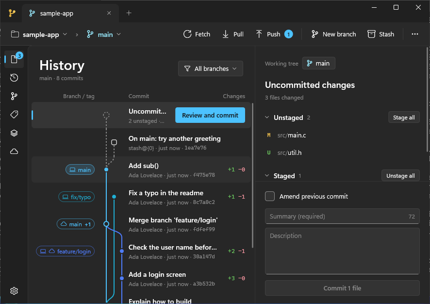
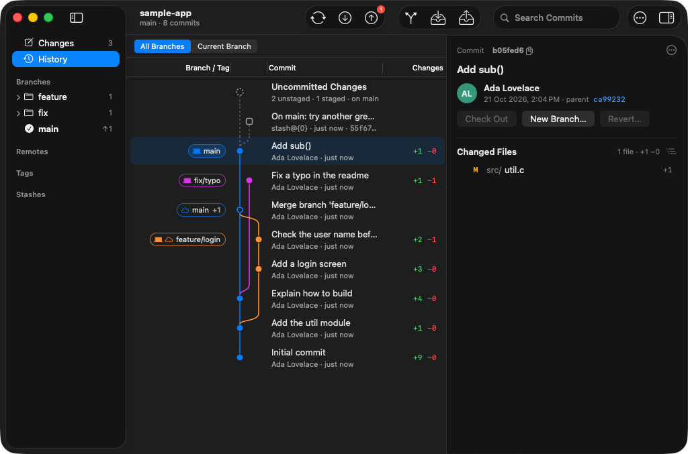
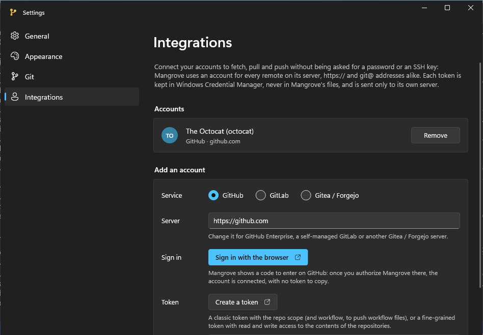
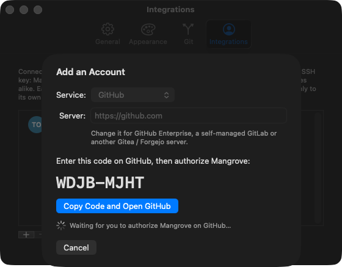
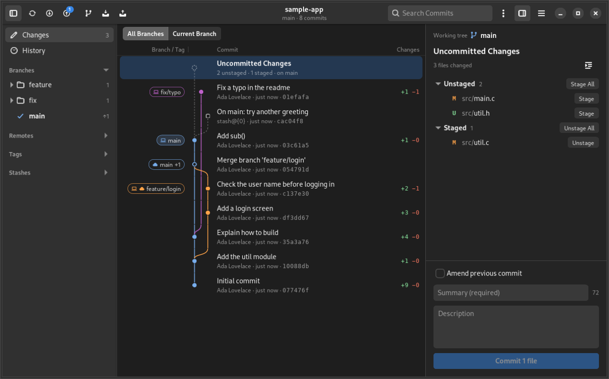
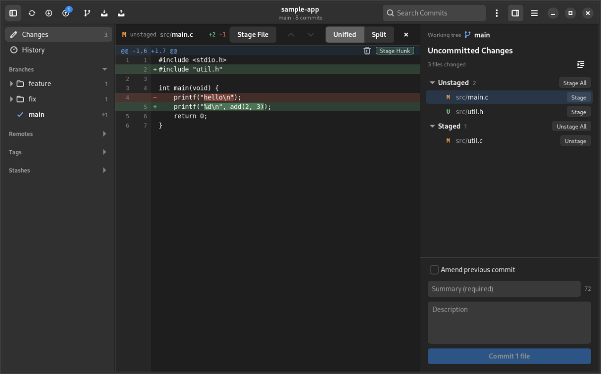
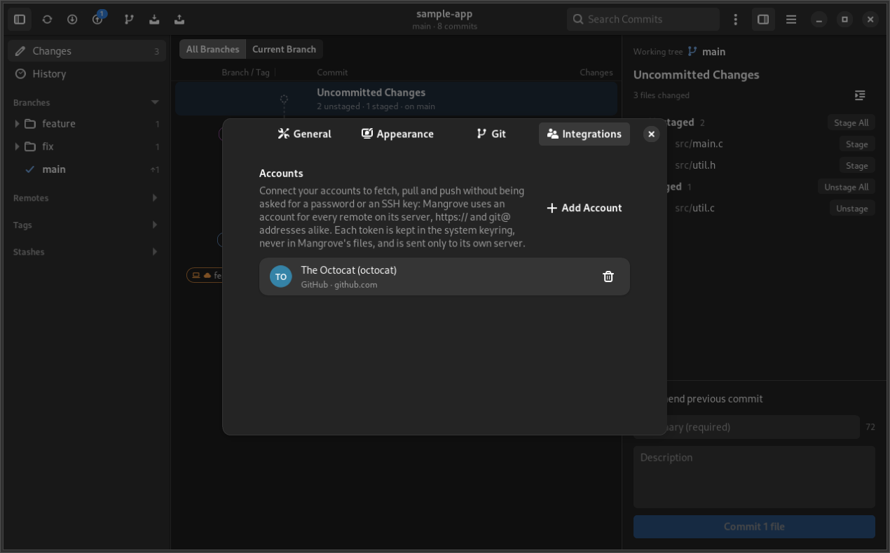
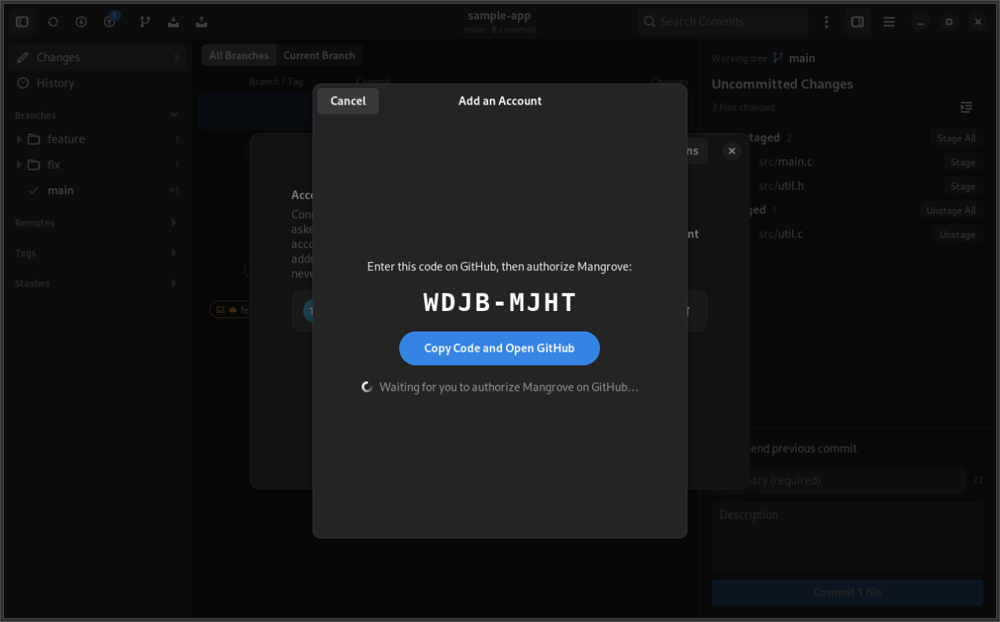

# Mangrove

**A lightweight, native Git client for Windows 11, macOS and Linux.**

Mangrove opens Git repositories and shows their history as a commit graph, with local and remote
branches, tags, stashes and uncommitted changes. It fetches, pulls and pushes, commits, stages whole
files or single hunks and lines, and undoes what it did. Each platform gets a real native app; the Git
logic underneath is one shared C++ core.

-1B2E5E)




## Light by design

Lightness is the point of Mangrove: small apps that start at once, stay out of the way and keep up
with huge repositories.

- **Tiny apps.** On Windows Mangrove is a single 1.2 MB executable (static C++ runtime, no
  installer, no dependencies). On macOS it is a 2.6 MB universal app (Apple silicon and Intel), a
  1.1 MB download. On Linux it is a 1.1 MB program, a 0.5 MB download, that uses the GTK and
  libadwaita already on the system.
- **Native UI, no web technology.** No Electron, no web view, no cross-platform UI toolkit and no
  runtime to load: Win32 with Direct2D/DirectWrite on Windows, AppKit on macOS, GTK 4 with
  libadwaita on Linux. The apps look, behave and scale like the rest of the system.
- **git does the git.** Mangrove runs the git that is already installed and reads its NUL-separated
  output as a stream on worker threads; log, refs, stashes and status load in parallel, and the
  interface never waits for them.
- **Only what is visible gets work.** History rows, the lines added and removed by each commit and
  the lines of a diff are laid out and loaded only when they come into view.
- **Measured.** On Git's own repository (85,596 commits, 1,022 refs) the history is ready in about
  0.8 s, 0.7 s of which is `git log`; the graph layout takes 35 ms and a scrolling frame about 2 ms.
  A 200,000-line diff opens in about 120 ms and scrolls at about 3 ms per frame.

## Screenshots

| Windows | macOS |
| --- | --- |
|  |  |
|  |  |

| Linux | |
| --- | --- |
|  |  |
|  |  |

## Features

**History.** A thin commit graph with smooth curves (dots for commits, rings for merges, a dashed
ring for uncommitted changes, squares for stashes) and two-line rows: summary, then author, relative
time and short SHA, plus the lines each commit added and removed. Branch and tag chips show
whether a branch is local, on a remote or both, and how far ahead or behind it is. Search by
message, author, SHA or ref name; show all branches or only the current one.

**Branches, tags, stashes, remotes, submodules.** Browsable in the sidebar, with folders and
ahead/behind counts; double-click to check out (a remote branch creates its tracking branch), or use
the context menus.

**Commit.** The uncommitted changes are the first row of the history. Stage and unstage files or
folders, discard changes (always confirmed), write a summary with a 72-character counter and a
description, amend the previous commit; during a merge git's prepared message is filled in.

**Diff.** Click a file to see its diff, unified or side by side, with changed words highlighted and
renames shown as `old → new`. On uncommitted changes, stage, unstage or discard a single hunk, or
just the lines you select. Mangrove builds the partial patches itself and hands them to `git apply`
with recomputed line numbers, so a change lands where it belongs even when the same text repeats in
the file. Binary files, new and empty files, merge conflicts (combined diff) and "no newline at end
of file" are handled; minified lines are cut around the change.

**Git actions.** Fetch (all remotes, pruning deleted branches), pull (merge if possible,
fast-forward only, or rebase, with local changes set aside and put back), push (creating the upstream
when there is none; when the remote is ahead, pull or force push with `--force-with-lease`), new
branch, stash and pop, check out, revert. Each runs on its own thread with git's progress on screen.
**Undo and redo** cover checkouts, new branches, stashes, commits and reverts made in Mangrove,
as long as nothing was pushed.

**Accounts.** Connect GitHub (including Enterprise Server), GitLab (including self-managed) and
Gitea / Forgejo (Codeberg or your own server), then fetch, pull and push without being asked for a
password or an SSH key. See [Accounts](#accounts).

**Settings.** By category: General, Appearance, Git, Integrations.

**And more.** Tabs, one per repository, reopened at launch. The view refreshes by itself when the
repository changes on disk. Repositories owned by another user account can be trusted for Mangrove
only, without touching git's global configuration. If git is missing, Mangrove says how to install
it.

### On Windows

- Laid out like the Windows 11 apps: tabs in the title bar, a command bar with a
  *repository › branch* breadcrumb, a navigation pane on **Mica**, Snap Layouts, native context
  menus, *Segoe UI Variable* and *Segoe Fluent Icons*, per-monitor DPI, zoom (`Ctrl`+`+`/`-`/`0`).
- **Themes:** the Windows theme (light or dark, following the system setting, with your accent
  color), light or dark on purpose, or **Mangrove**, the original navy and gold. Contrast themes
  always win.
- The Settings window follows the Windows 11 Settings app (`Ctrl+,`).
- **One instance:** starting Mangrove again, even with folders on the command line, brings the open
  window to the front and opens the folders there. Another settings file (`MANGROVE_SETTINGS`) is
  another instance.
- Write commands go through Git for Windows' launcher, so hooks, SSH and Git Credential Manager work
  as they do in a terminal.

### On macOS

- AppKit throughout: native window tabs, a source-list sidebar, an inspector for the details, a
  unified toolbar, SF Symbols, system alert sheets, FSEvents for refreshing.
- Follows the light or dark appearance and the accent color of the system, or a fixed light or dark
  appearance.
- The standard Settings window with a toolbar of panes (`⌘,`).
- A universal app for macOS 12 or later; drop a folder on the Dock icon to open it.

### On Linux

- GTK 4 and libadwaita, laid out like the GNOME apps: a header bar with the repository's actions,
  tabs that can be dragged out into a window of their own, a sidebar, adaptive dialogs and the
  keyboard shortcuts window (`Ctrl+?`). At home on GNOME, and it works on other desktops too, on
  Wayland or X11.
- Follows the system's light or dark style, its accent color (libadwaita 1.6 or later) and its
  interface font, or a fixed light or dark style.
- Settings in a GNOME preferences dialog (`Ctrl+,`).
- **One instance:** starting Mangrove again, even with folders on the command line, brings the open
  window to the front and opens the folders there (through D-Bus). Another settings file
  (`MANGROVE_SETTINGS`) is another instance.
- Tokens in the Secret Service keyring (GNOME Keyring, KWallet, KeePassXC…) through libsecret;
  inotify for refreshing; *Open in Terminal* opens your terminal (`xdg-terminal-exec`, Ptyxis, GNOME
  Console, GNOME Terminal, Konsole and others).
- Drop a folder on the window to open it.

## Accounts

- **Sign in with the browser** (github.com): Mangrove asks GitHub for a one-time code and shows it;
  *Copy the code and open GitHub* copies it and opens the page where you paste it and authorize
  Mangrove (scopes `repo`, `workflow`, `read:user`). Mangrove meanwhile asks GitHub every few
  seconds whether you did (the OAuth 2.0 device flow, RFC 8628, with no client secret), then gets the
  token. Organizations that restrict OAuth apps have to approve Mangrove for their repositories, or
  you can use a token.
- **Or paste a personal access token.** *Create a token* opens the service's page for a new token
  with its name and scopes filled in. The token box shows dots and won't let the token be copied.
- **Checked before it is kept.** Mangrove asks the server whom the token belongs to (the API's
  `/user`, HTTPS only, no redirects followed) and warns when it couldn't push (a classic GitHub token
  without `repo`).
- **Kept by the system.** Tokens live in **Windows Credential Manager**, the **macOS keychain** or
  the **Secret Service** keyring on Linux, never in Mangrove's files: `settings.ini` only lists the
  service, the server and the user name. Removing an account deletes its token there (it stays valid
  on the server until you revoke it).
- **Used only for its server.** For fetch, pull and push, git gets the token for that one command
  through environment variables (`GIT_CONFIG_COUNT`, `GIT_CONFIG_KEY_n`, `GIT_CONFIG_VALUE_n`: an
  `http.<server>/.extraHeader`, git 2.31 or later): never on a command line, never in git's
  configuration, and sent to that server only. Remotes with an SSH address on the same server
  (`git@github.com:…`, `ssh://git@github.com/…`) are read as HTTPS ones for those commands
  (`url.<server>/.insteadOf`), so they need no SSH key. Other remotes work as before; when a server
  refuses an SSH key, the message suggests connecting the account.
- GitLab stays with tokens: its OAuth tokens expire after two hours.

### Mangrove's GitHub OAuth app

Signing in with the browser goes through the OAuth app *Mangrove* registered on GitHub. Its client ID
is `kGitHubClientId` in `src/core/accounts.cpp`; like the ones of GitHub CLI and Git Credential
Manager it isn't a secret, and no client secret is needed. Without a client ID the button doesn't
appear. To publish your own build with your own app:

1. *Settings › Developer settings › OAuth Apps › New OAuth App*
   (<https://github.com/settings/applications/new>).
2. *Homepage URL* and *Authorization callback URL*: the repository's address (the device flow
   doesn't use the callback, but the field is required).
3. Tick **Enable Device Flow**; untick **Expire user access tokens** (Mangrove doesn't renew tokens,
   which would otherwise expire after 8 hours) and leave *Allow wildcard matching* off.
4. Put the client ID in `kGitHubClientId`. To try another app without rebuilding, the
   `MANGROVE_GITHUB_CLIENT_ID` environment variable overrides the built-in one.

## Download

Every push to `main` builds the three apps on GitHub Actions: open the latest run of the
[Build workflow](https://github.com/Legoraccio/Mangrove/actions/workflows/build.yml) and download
**Mangrove-Windows** (the executable, zipped), **Mangrove-macOS.zip** (the app; double-click to
unzip) or **Mangrove-Linux.tar.gz**. You need git: [Git for Windows](https://git-scm.com/download/win)
on Windows; on macOS the Xcode Command Line Tools (`xcode-select --install`) or Homebrew's git; on
Linux your distribution's (`sudo apt install git`, `sudo dnf install git`).

On Linux, extract the archive and start `./mangrove`, or run `./install.sh` to put Mangrove among
your applications (in `~/.local`, no administrator rights; `./install.sh --uninstall` removes it).
It needs GTK 4.14 and libadwaita 1.5 or later: Ubuntu 24.04, Fedora 40, Debian 13 or newer.

The Windows and macOS builds aren't signed yet, so the systems ask before the first start:

- **Windows:** SmartScreen may warn about an unknown app; Smart App Control, when it is on, blocks
  unsigned apps that Microsoft's cloud doesn't know yet.
- **macOS:** the app is signed *ad hoc* and not notarized, so macOS blocks it the first time. Allow it
  once in *System Settings › Privacy & Security › Open Anyway*, or run
  `xattr -dr com.apple.quarantine Mangrove.app`.

## Building

### Windows

Requirements: Visual Studio 2022 or 2026 with the *Desktop development with C++* workload, and Git
for Windows. The Windows SDK is downloaded on the first build from Microsoft's official NuGet
packages into `deps` (no administrator rights needed).

```powershell
.\build.ps1          # release -> bin\Mangrove.exe
.\build.ps1 -Run     # build, then start it
.\build.ps1 -Dbg     # debug build -> bin\Mangrove-debug.exe
```

### macOS

Requirements: macOS 12 or later with Xcode, or just the Xcode Command Line Tools
(`xcode-select --install`). There is no Xcode project: the script builds with `clang++` from the
command line.

```bash
./build-mac.sh            # universal release (Apple silicon + Intel) -> bin/Mangrove.app
./build-mac.sh --run      # build, then open it
./build-mac.sh --native   # only for this Mac's processor (faster)
./build-mac.sh --debug    # debug build -> bin/Mangrove-debug.app
```

A build runs on the Mac that made it. To give it to others, sign it with a Developer ID certificate
and notarize it.

### Linux

Requirements: a C++20 compiler, GTK 4.14 and libadwaita 1.5 or later, libcurl and libsecret, with
their development files (Ubuntu 24.04, Fedora 40, Debian 13 or newer have them all), and git:

```bash
# Ubuntu, Debian
sudo apt install build-essential pkg-config libgtk-4-dev libadwaita-1-dev libcurl4-openssl-dev libsecret-1-dev git
# Fedora
sudo dnf install gcc-c++ pkgconf-pkg-config gtk4-devel libadwaita-devel libcurl-devel libsecret-devel git
# Arch
sudo pacman -S --needed base-devel gtk4 libadwaita curl libsecret git
```

```bash
./build-linux.sh             # release -> bin/mangrove
./build-linux.sh --run       # build, then start it
./build-linux.sh --install   # build, then install it for you (~/.local), with its menu entry and icon
./build-linux.sh --debug     # debug build -> bin/mangrove-debug
```

The styles, the icons and the keyboard shortcuts window are compiled into the program
(`glib-compile-resources`, part of GLib's development files).

### Icons

`tools\make-icon.ps1` regenerates `src\windows\mangrove.ico` and `src\macos\AppIcon.png` (from which
`build-mac.sh` makes the `.icns`). The Linux icon is the same design as a vector drawing,
`src/linux/data/icons/scalable/apps/io.github.legoraccio.Mangrove.svg`.

## Tests

- **`tools/coretest`** (`run.ps1` on Windows, `run.sh` on macOS and Linux): the shared core, the same
  on every platform: UTF-8/16/32 text, paths and command lines, the sidebar trees, interface texts, the
  settings file, accounts (token checks, git's authorization environment, the credential store) and a
  real repository created in the temporary folder and read with git (history, refs, graph, status,
  details, diffs, line counts). On Linux the credential store is tested with `MANGROVE_TEST_SECRETS=1`,
  in a session with an unlocked keyring (as CI does).
- **`tools/patchtest`** (`run.ps1` / `run.sh`): partial patches. It stages, unstages and discards every
  hunk, every line and hundreds of random selections in a throwaway repository (files without a final
  newline, CRLF, deleted and new files, repeated blocks), and checks with `git diff` that exactly the
  selection moved, at the right lines.
- **`tools/uitest`**: interface smoke tests. `mac-snapshots.sh`, `win-snapshots.ps1` and
  `linux-snapshots.sh` open a throwaway repository in the app, which saves pictures of its windows
  (history, diff, every settings page; on Windows in three themes) and quits; `win-single-instance.ps1`
  and `linux-single-instance.sh` check that a second start hands its folder to the first one. On
  Windows and macOS they bring windows to the front: they are meant for CI machines. On Linux they run
  on a virtual display (Xvfb) when there is none.
- **GitHub Actions** (`.github/workflows/build.yml`) builds the three apps on every push to `main`,
  runs all the tests, and publishes the apps and the pictures (*mac-snapshots*, *windows-snapshots*,
  *linux-snapshots*). The screenshots above come from there.

## Project layout

| Folder / file | What it holds |
| --- | --- |
| `src/core/` | **the shared core**, portable C++20 |
| `src/core/git.cpp` | running git, streaming parsers, ordering, details, line counts, status, diffs and partial patches |
| `src/core/graph.cpp` | the lanes of the commit graph |
| `src/core/session.cpp` | `RepoSession`, an open repository: loading and refreshing, selection, details, search, queued git operations with undo and redo, diffs with line selection; results reach the interface thread as events |
| `src/core/accounts.cpp` | GitHub, GitLab and Gitea / Forgejo accounts: the browser sign-in, token checks, git's authorization |
| `src/core/present.cpp` | the texts and confirmation prompts all the interfaces show |
| `src/core/navtree.cpp` | trees of branches, remotes, tags and files; a ref's state against its remote |
| `src/core/settings.cpp` | the shared settings file |
| `src/core/text.cpp` | UTF-8 and wide text, paths, dates, command lines |
| `src/core/platform_win.cpp`, `platform_posix.cpp` | system services: processes, files, git, clocks, file watching (`ReadDirectoryChangesW` / FSEvents / inotify), HTTPS (WinHTTP / libcurl), credentials (Credential Manager / keychain / Secret Service) |
| `src/windows/` | **the Windows app**: `app.cpp` (window, input, sidebar), `views.cpp` (painting, immediate mode with hit-test zones), `diffview.cpp`, `actions.cpp` (session events, dialogs, text fields), `settingswindow.cpp`, `instance.cpp` (one instance), `gfx.cpp` (Direct2D / DirectComposition), `theme.cpp`, `snapshots.cpp` (pictures for the tests) |
| `src/macos/` | **the macOS app**, Objective-C++: `App.mm` (application, menus, restored tabs), `RepoWindow.mm` (window, toolbar, session events, prompts), `Sidebar.mm`, `History.mm`, `Details.mm`, `DiffView.mm`, `Preferences.mm` (Settings), `Bridge.mm` (text, colors, symbols) |
| `src/linux/` | **the Linux app**, GTK 4 and libadwaita: `app.cpp` (application, one instance, shortcuts, pictures for the tests), `window.cpp` (windows and tabs, header bar, session events, prompts), `history.cpp`, `sidebar.cpp`, `details.cpp`, `files.cpp` (file lists), `diffview.cpp`, `preferences.cpp` (Settings), `ui.cpp` (drawing, the `Canvas` widget of the long lists, menus); `data/` (styles, icons, the shortcuts window, the menu entry, `install.sh`) |
| `tools/` | icons and tests |

## Configuration

Settings live in `%APPDATA%\Mangrove\settings.ini` on Windows, in
`~/Library/Application Support/Mangrove/settings.ini` on macOS and in `~/.config/mangrove/settings.ini`
on Linux (`$XDG_CONFIG_HOME`). Mangrove used to be called DreamTree: the first start reads
DreamTree's settings (tabs, recent repositories, theme).

Environment variables, mostly for tests:

| Variable | Effect |
| --- | --- |
| `MANGROVE_SETTINGS=<file>` | another settings file (separate profiles, tests); on Windows and Linux, also another instance |
| `MANGROVE_DEBUG=1` | Windows: a diagnostics strip (zone under the pointer, focus, timings, cached diff layouts); the pointer can be driven by posted messages |
| `MANGROVE_ACCENT=RRGGBB` | Windows: this accent color instead of the system's |
| `MANGROVE_CONTRAST=1` | Windows: behave as if a contrast theme were on |
| `MANGROVE_SNAPSHOT=<folder>` | save pictures of the windows in that folder, then quit (interface tests) |
| `MANGROVE_GITHUB_CLIENT_ID=<id>` | another GitHub OAuth app for signing in with the browser |

## Keyboard shortcuts

### Windows

| Keys | Action |
| --- | --- |
| `Ctrl+O` / `Ctrl+T` / `Ctrl+W` | open a repository / new tab / close the tab |
| `Ctrl+Tab` | next tab |
| `↑ ↓ PgUp PgDn Home End` | move through the commits (with a diff open: scroll it) |
| `Ctrl+F` | search the history; `Enter` / `Shift+Enter` next / previous result, `Esc` clears |
| `F3` / `Shift+F3` | next / previous search result |
| `Esc` | clear the line selection, then close the diff |
| `F5` / `Ctrl+R` | reload |
| `Ctrl+K` | full sidebar / icons only |
| `Ctrl+J` | show or hide the details |
| `Ctrl+C` | copy the selected commit's SHA |
| `Ctrl+B` | new branch at the selected commit |
| `Ctrl+Z` / `Ctrl+Y` | undo / redo the last action |
| `Ctrl` + `+` `-` `0`, `Ctrl` + wheel | zoom |
| `Ctrl+,` | settings (`Ctrl+Tab` switches the page, `Esc` closes) |

### macOS

| Keys | Action |
| --- | --- |
| `⌘O` / `⌘T` / `⌘W` | open a repository / new tab / close |
| `⌘F`, `⌘G` / `⇧⌘G` | search the history, next / previous result (`↩` / `⇧↩` in the field too) |
| `⌘1` / `⌘2` | history / uncommitted changes |
| `⇧⌘F` / `⇧⌘P` / `⌘P` | fetch / pull / push |
| `⇧⌘N` | new branch at the selected commit |
| `⌥⌘S` / `⌥⇧⌘S` | stash / pop |
| `⌥⌘Z` / `⌥⇧⌘Z` | undo / redo the last git action (`⌘Z` stays text undo) |
| `⌘R` | reload |
| `⌃⌘S` / `⌥⌘I` | sidebar / details |
| `⌥⌘B` | current branch only |
| `⌘C` | copy the selected commit's ID |
| `⌘↩` | commit |
| `Esc` | clear the line selection, then close the diff |
| `⌘,` | settings |

### Linux

| Keys | Action |
| --- | --- |
| `Ctrl+O` / `Ctrl+T` / `Ctrl+W` | open a repository / new tab / close the tab |
| `Ctrl+N` | new window |
| `Ctrl+Tab`, `Alt+1`…`9` | next tab, a tab by its number |
| `↑ ↓ PgUp PgDn Home End` | move through the commits (with a diff open: scroll it) |
| `Ctrl+F`, `Ctrl+G` / `Shift+Ctrl+G` | search the history, next / previous result (`Enter` / `Shift+Enter` in the field too) |
| `Ctrl+1` / `Ctrl+2` | history / uncommitted changes |
| `Shift+Ctrl+F` / `Shift+Ctrl+P` / `Ctrl+P` | fetch / pull / push |
| `Shift+Ctrl+N` | new branch at the selected commit |
| `Ctrl+Alt+S` / `Shift+Ctrl+Alt+S` | stash / pop |
| `Ctrl+Alt+Z` / `Shift+Ctrl+Alt+Z` | undo / redo the last git action (`Ctrl+Z` stays text undo) |
| `Ctrl+R`, `F5` | reload |
| `F9` / `Ctrl+Alt+I` | sidebar / details |
| `Ctrl+Alt+B` | current branch only |
| `Ctrl+C` | copy the selected commit's ID |
| `Ctrl+Enter` | commit |
| `Esc` | clear the line selection, then close the diff |
| `Ctrl+,` / `Ctrl+?` / `Ctrl+Q` | settings / keyboard shortcuts / quit |

## License

Mangrove is released under the [PolyForm Noncommercial License 1.0.0](LICENSE.md): you may use, study,
change and share it freely for **noncommercial** purposes (personal use, study, research, hobby
projects, charities, schools and universities, public institutions), keeping the copyright notice.
Commercial use isn't allowed; for a commercial license, contact the author,
[@Legoraccio](https://github.com/Legoraccio).

Copyright (c) 2026 Roberto Di Miceli.
